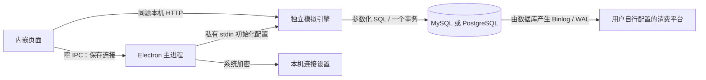

# 架构与职责

`engine/signal_source.py` 是字段、合成数据和SQL事务真源。`dashboard.py` 管理手动/自动运行、互斥锁、轮询、同源命令和静态页面；`desktop_service.py` 只增加连接测试/替换及显式初始化。

`desktop/main.cjs` 只负责本机进程、窗口和保存设置。渲染器没有 Node 能力；开启 contextIsolation 和进程 sandbox，拒绝新窗口、权限请求和外部导航。预加载仅暴露保存连接、读取版本两个受校验IPC；不能传递文件路径、SQL或可执行命令。

模拟引擎仅监听随机 loopback 端口。连接密码由主进程通过私有stdin传入，不在进程参数和响应中返回。命令需要准确Host、同源Origin、随机nonce。随机nonce不是用户登录账号。

退出时通过控制接口和stdin EOF停止引擎。每一批独立事务，未完成操作回滚；已提交数据不回退。数据库命名、精确字段/主键及InnoDB验证继续执行；初始化不删除表，不接受部分结构或夹有其他业务表的专用库。

本机设置位于系统用户应用数据目录的 `MockIncrementalData/connections.json`；密码用 Electron safeStorage 加密。缺少安全密钥存储时拒绝明文落盘，可在当前会话继续使用。复制安装文件夹不会复制用户的配置或密码。

单个实例可以分别维护MySQL和PostgreSQL配置；各源最多一个模拟写入线程。数据库锁还防止第二个模拟器进程同时写入。读取的最新10行只用于源端观察，不表示下游消费已经完成。

慢连接的页面状态请求串行执行，最多补发一次刷新，避免响应超过3秒时被后来的轮询一直覆盖。PostgreSQL优先测试配置的目标库；已有库不要求维护库连接或建库权限。所有PostgreSQL业务连接固定使用public schema，与结构校验范围一致。
